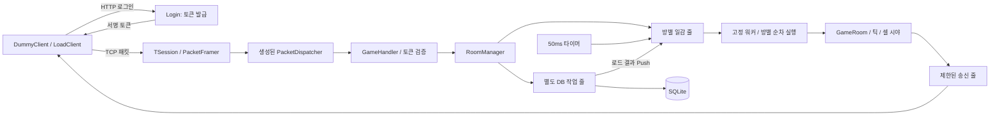

# MyServer

C#과 .NET 8로 구현한 TCP 멀티플레이 게임 서버 포트폴리오입니다. 연결 처리, 게임 상태의 순차 실행, 틱과 시야, 방 이동, 토큰 로그인, 저장과 정상 종료를 연결하고 자동 테스트와 실제 클라이언트로 검증합니다.

## 구현한 기능

- 길이·종류 헤더로 TCP 스트림을 패킷으로 분리하고, 분할·합쳐진 수신을 처리합니다.
- JSON 정의에서 패킷 클래스·번호·요청 인터페이스·분배기를 생성합니다. 잘못된 길이·UTF-8·비유한 좌표·알 수 없는 번호는 거절합니다.
- 방별 일감 줄과 고정 워커를 사용합니다. 같은 방은 한 번에 하나씩 실행하고, 서로 다른 방은 함께 처리합니다.
- 50ms 간격의 틱에서 마지막 이동만 반영합니다. 10×10 셀과 주변 3×3 시야로 이동·채팅·입퇴장 알림을 제한합니다.
- 여러 방 사이를 이동하며 확정 위치를 보존합니다. 이름은 전체 방에서 중복되지 않게 예약합니다.
- HTTP에서 발급한 서명 토큰으로 게임에 접속합니다. 변조·만료·발급자 불일치를 거절합니다.
- SQLite 작업은 별도 순차 작업 줄에서 수행합니다. 퇴장 시 위치·방을 저장하고 재접속 시 복원합니다.
- 송신 대기 한도는 기본 1,024패킷·1MiB이며 진행 중인 쓰기도 포함합니다. 한도를 넘긴 연결을 종료합니다.
- 정상 종료 시 접속·틱을 멈춘 뒤 퇴장·저장·방 일감·워커를 정리합니다. 클라이언트는 입력 대기 중에도 서버 종료를 감지합니다.
- 자동 부하 클라이언트와 UTC 구간별 틱 시간·대기량·송수신량 측정을 제공합니다.

## 빠르게 실행하기

검증 환경은 Windows, .NET SDK **10.0.401**, .NET/ASP.NET Core **8.0.31**, PowerShell 7입니다. 솔루션은 `.slnx`, 프로젝트 대상은 `net8.0`입니다.

저장소 루트에서 빌드와 테스트를 실행합니다.

```powershell
dotnet build -c Release
dotnet test -c Release --no-build
```

Login과 Game을 함께 시작합니다.

```powershell
pwsh -NoProfile -File ./scripts/Start-Demo.ps1 -NoBuild
```

스크립트는 공유 키가 없으면 현재 실행에 사용할 임시 키를 만들고 두 서비스에 전달합니다. 키를 파일·인자·로그에 기록하지 않습니다. 기본 주소는 HTTP `127.0.0.1:5000`, 게임 TCP `127.0.0.1:7777`, 방 3개·워커 2개입니다. DB는 `data/players.db`, 로그는 `logs/`, 종료 시 측정 자료는 `artifacts/tick-metrics.json`에 남습니다. 종료는 Ctrl+C입니다. 상세 게임 로그는 `-Verbose`로 켭니다.

다른 터미널에서 클라이언트를 실행하고 서로 다른 이름을 입력합니다.

```powershell
dotnet run -c Release --no-build --project DummyClient
```

| 입력 | 동작 |
|---|---|
| 일반 문장 | 자신과 시야 안의 상대에게 채팅 |
| `/move 3.5 7` | 맵 0~100 안에서 이동 요청 |
| `/room 2` | 2번 방으로 이동 |
| 빈 줄 | 접속 종료 |

이미 사용 중인 서버와 분리해서 실행할 수도 있습니다.

```powershell
pwsh -NoProfile -File ./scripts/Start-Demo.ps1 -NoBuild -Port 17777 -LoginPort 18080
dotnet run -c Release --no-build --project DummyClient -- --port 17777 --login-url http://127.0.0.1:18080/login
```

서비스를 개별 실행하려면 Login과 Game에 동일한 Base64 키를 `MY_SERVER_TOKEN_KEY` 환경변수로 설정하고 각각 다른 터미널에서 실행합니다. 키는 무작위 32바이트 이상이어야 합니다. 클라이언트는 공유 키가 필요 없습니다. Login의 기본 개발 실행 프로필은 5152이므로, 기본 클라이언트와 맞출 때는 주소를 명시합니다. 개별 Game 실행의 기본 DB는 실행 파일 옆 `data/players.db`입니다.

```powershell
dotnet run --project Login --no-launch-profile --urls http://127.0.0.1:5000
dotnet run --project Game -- --port 7777 --workers 2 --rooms 3
```

## 처리 구조와 선택 이유



게임 상태는 방의 일감 처리 안에서만 바꿉니다. 워커가 달라져도 같은 방의 실행이 겹치지 않게 예약하며, 한 번에 32개씩 처리해 다른 방에도 실행 기회를 줍니다. 방 이동은 기존 방에서 제거한 뒤 대상 방에 추가합니다. 응답 직후의 요청이 빠지지 않도록 수신 가능 상태와 알림 순서도 테스트합니다.

이동 요청은 예정 위치를 덮어쓰고, 틱이 모든 최종 위치를 확정한 뒤 시야 변화를 계산합니다. 새롭게 보인 상대에게는 위치가 포함된 입장 알림만 보내며 같은 위치의 이동 알림을 중복하지 않습니다.

SQLite의 ADO.NET 비동기 메서드도 동기 실행되므로, 실제 SQL을 별도의 작업 줄에서 실행합니다. 저장·로드 순서를 보장하고, 로드 결과의 방 처리가 끝날 때까지 추적합니다. 이름 예약을 해제하기 전에 저장을 줄에 넣어 빠른 재접속에서 이전 위치를 읽는 문제를 막습니다. [Microsoft.Data.Sqlite 비동기 제한](https://learn.microsoft.com/en-us/dotnet/standard/data/sqlite/async)

문자열은 `int32 UTF-8 바이트 길이 + 문자열`, 숫자는 little-endian입니다. 프레임 헤더는 `uint16 전체 길이 + uint16 패킷 번호`입니다. 본문 전체가 정확히 읽혀야 유효한 패킷으로 처리합니다.

## 패킷 정의 변경

`Protocol/packets.json`을 수정한 뒤 생성·빌드·테스트합니다. 생성된 `.g.cs`도 함께 커밋합니다.

```powershell
dotnet run --project PacketGenerator -- Protocol/packets.json .
dotnet build -c Release
dotnet test -c Release --no-build
```

새 요청은 기본 인터페이스 구현으로 빌드할 수 있고, 처리 함수를 작성하기 전에는 연결을 종료합니다. 자세한 정의 규칙은 [패킷 생성기 설명](PacketGenerator/README.md)에 있습니다.

## 검증과 부하 재현

2026-10-28 기준 Release 빌드 경고·오류 0개, 자동 테스트 **276개 통과**입니다. 패킷 경계·직렬화·분배·인증·시야·워커·방 이동·DB 경합·송신 한도·종료를 확인합니다. 실제 프로세스로 로그인·입퇴장·방 이동·서버 재시작 복원·입력 대기 중 서버 종료 감지와 Ctrl+C 정리도 확인했습니다.

2026-10-28 실측 결과입니다. 서버와 부하 클라이언트는 같은 Windows PC에서 실행했습니다(.NET 8.0.31, 환경이 보고한 프로세서 수 16).

| 항목 | 실측 |
|---|---|
| 클라이언트 | 500명, 측정 시작·종료 모두 연결 유지 |
| 방 / 워커 | 3개 방(167·167·166명) / 워커 2개 |
| 워밍업 / 측정 | 2초 / 10.013초 |
| 이동 요청 / 확정 위치 변경 수신 | 50,000개 / 49,986개, 500명 전원 확정 수신 |
| 틱 샘플 | 600개, 방마다 200개 |
| 최대 / p95 / p99 | **12.4691ms / 1.0631ms / 3.1717ms** |
| 50ms 초과 / 클라이언트 오류 | **0개 / 0개** |
| 틱 샘플의 최대 대기 일감 | 122개 |
| 종료 후 접속 / 일감 / DB 작업 | 0개 / 0개 / 0개 |

틱 시간은 이동 확정·시야 갱신·패킷 작성·송신 줄 등록까지의 실행 시간입니다. 일감 대기량도 함께 기록합니다. 이 실측에는 별도의 2클라이언트 부정 검증이 약 1초 겹쳤으며, 해당 활동을 포함한 수치를 보관했습니다. [원시 샘플과 실행 조건](benchmarks/latest.json)

서버가 이동 요청을 읽고도 확정 알림을 보내지 않는 스텁에서는 연결·전송이 성공해도 부하 검증이 실패하도록 확인했습니다. [부정 검증 결과](benchmarks/negative-control.json)

```powershell
pwsh -NoProfile -File ./scripts/Run-LoadTest.ps1
```

이 스크립트는 기본 17777·15000 포트에서 별도 서비스와 DB를 사용합니다. 클라이언트 500명이 HTTP 로그인 후 3개 방에 나뉘어 이동하며 패킷을 계속 읽습니다. 준비 구간 뒤 측정한 클라이언트 UTC 구간과 서버 틱 샘플을 맞춰 최대·p95·p99·50ms 초과 수·대기량을 계산합니다. 전원 접속·이동, 오류 0, 충분한 틱 수, 틱 최대 50ms 이내와 정상 종료를 모두 확인해야 성공으로 기록합니다.

요약과 측정 구간의 원시 샘플은 `benchmarks/latest.json`, 실행 로그·전체 샘플·테스트 DB는 `artifacts/`에 남습니다. 실측 수치와 실행 환경은 결과 파일을 기준으로 봅니다.

## 범위와 한계

- HTTP 로그인은 이름만으로 토큰을 발급하는 데모입니다. 계정·비밀번호 인증, TLS와 요청량 제한은 구현하지 않았습니다. 토큰 형식은 버전이 있는 사설 HMAC입니다.
- 한 프로세스의 고정 방과 셀 시야를 다룹니다. 속도·충돌 검사, 전투, 서버 간 분산은 범위에 포함하지 않았습니다.
- 저장 기준은 퇴장·정상 종료의 마지막 틱 확정 위치입니다. 강제 프로세스 종료 직전의 미저장 이동은 복원하지 않습니다.
- 송신 줄은 제한하지만 방의 수신 일감 줄은 크기 제한이 없습니다. SQLite 스키마 자동 마이그레이션도 범위 밖입니다.

단계별 범위와 확인 기록은 [ROADMAP.md](ROADMAP.md)에 있습니다.
